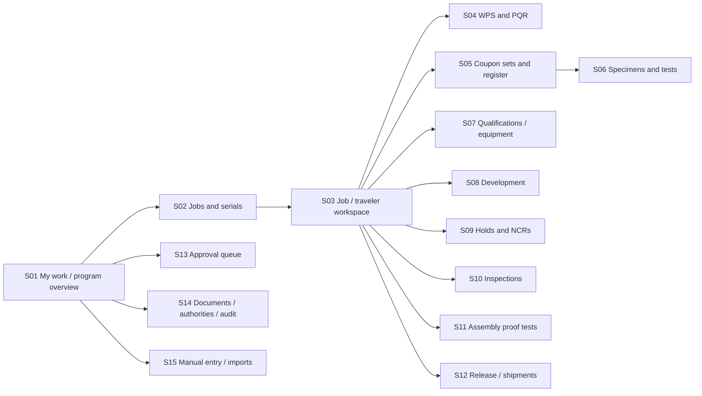

# Application screen map

Responsive browser application for shop-floor use, office QC entry and Picogrid review. User clarification supports online use with manual/assisted work; it does not require disconnected digital approvals. Screen names are proposed. Every engineering action is enforced server-side and scoped by an effective authority grant, regardless of screen visibility.

## Navigation and access

An operator/person may have no account and use signed/manual records through an authorized helper. S15 is an entry channel into the same controlled records, not a parallel set of facts. Broad program read access for Picogrid and AM Kreations/developer reflects the user's clarification; Each organization will have a senior internal approver within procedural limits; Cone owners were given as examples. Cone shared program reads and senior organizational management of own backup grants/self-approval policy are confirmed A05/A06; specific people/technical evidence remain B-level. The user personally has unrestricted application owner authority (Q19), with separately attributable interventions; this is not granted to other developers by read access.

## Screen/action matrix

| ID / screen | Main content and actions | Record owners / eligible actions | Requirement coverage |
| --- | --- | --- | --- |
| S01 My work / program overview | Jobs by actual operation state, pending tests/approvals, scoped holds, upcoming approved checkpoints, open engineering TBDs; drill to source | Authorized program readers; each person sees permitted tasks; no single green “approved” program badge | R01/R05/R11/R49–53 |
| S02 Jobs and serials | Work orders, drawing revisions, batches and explicit serial membership; search by serial/job/machine/coupon | Cone entry/designated staff; Picogrid/AM Kreations read per grants | R02/R17/R32/R44/R52 |
| S03 Job / traveler workspace | M step and next permitted action; readiness, all applicable triggers/coverage, operators/machine/materials; linked evidence, final inspections, holds and release; print/export identified traveler | Cone performers enter; designated personnel decide Gates 1/2 through linked screens; external traveler link where approved | R02–08/R12–19/R23/R26/R41/R44 |
| S04 WPS / PQR controlled records | Separate instruction and actual-evidence views; revisions, pass requirements versus actuals, supporting coupons/tests, scope/limits, preliminary/approved status | Preparers edit drafts; Picogrid procedure approval via S13; read-only frozen revisions | R01/R27–31/R38–43/R48 |
| S05 Coupon set workspace / derived register | Purpose and caller, individual coupon IDs, family/drawings/material/setup/actual pass data, linked obligations/serials, pre-/post-finish evidence, acceptance; conditional fields | Cone prepares; designated acceptance; evidence links into C/D/H; no forced duplicate PQR entry | R17–26/R28–29/R39/R43/R46 |
| S06 Specimens / tests / reports | Physical coupon→specimen labels/layout/prep/integrity, pre-cut evidence, method/fixture/lab, report attempts, validity and technical acceptance shown separately | Test/inspection staff enter; Cone designated accept; competency rules TBD | R20–25/R29/R48 |
| S07 Qualifications / equipment | Person/machine/WPS subject scopes and awards; unique machine IDs; continuity evidence, maintenance classification and A/C/B follow-up | Cone maintains; Cone operator/equipment approvals and Picogrid procedure approvals through separate grants | R27–31/R45/R49 |
| S08 Development workspace | Trial objective/variables, root/cover actuals and observations, separate development evidence, finishing trials, preliminary WPS and C link | Assigned development lead (identity TBD); technical contributors; no production authority | R38–40/R46 |
| S09 Issue / Engineering Hold / NCR | Unified issue context, separate process hold and hardware NCR panels; stop/tag/scope/origin, affected serials/last good check, notification, cause/action, H-required A, B/C, disposition/execution/closure/return gate | Operator raises; responsible party investigates; authorized Cone process closure; Picogrid hardware disposition approval with Cone collaboration; named appointees TBD | R14–16/R24–25/R32–37/R50 |
| S10 Inspection workspace | Stage-specific VT/dimensional data, actual measurements/units/gauge/drawing, pre-/post-finish, correction/reinspection links; final acceptance evidence | Performers/inspectors per defined roles; no implied welding qualification = inspection authority | R07–08/R20–22/R37/R48 |
| S11 Serial assembly proof test | Approved applicability/setup, load configuration/attachments, static result, drop height/reference/orientation/support/impact/rigging, post-test observations, result and evidence | Test/inspection entry and approval authority TBD; failures link H | R47/R08/R48 |
| S12 Gate 2 / release / shipment dossier | Per-population evidence checklist; YES/NO/pending coupon route; Cone normal release; explicit Picogrid at-risk request/conditions; actual shipment/CoC; later results | Cone release delegates; Picogrid at-risk approvers; shipment entry roles TBD | R08–11/R35–37/R47/R53 |
| S13 Decisions and approvals | Exact revision, evidence manifest, scope, actor's authority, conditions, approve/reject/request correction; externally signed evidence entered distinctly | Action-specific grants for ordinary users; explicit personal owner approval/override with original evidence retained | R04/R09–10/R23/R26/R30/R35–37/R42/R50 |
| S14 Controlled documents / program configuration / authority / audit | Source/revision/status and mappings, unresolved controls, requirement proposals and approval, memberships versus engineering grants, revision/audit viewer | AM Kreations administration; Picogrid controlled changes; organization designators TBD | R01/R42/R44/R48–51 |
| S15 Manual/assisted entry / migration review | Worker versus entry person/date, paper scan/source references, missing data flags, raw import review and field mapping; duplicate detection; publish into appropriate draft record | Authorized entry/review users; helper cannot sign as another person; signed-paper approval accepted for appropriately authorized approvers; no mandatory worker digital reconfirmation | R41–46/R51–53 |

## Key interaction details

**Job workspace:** show job/serial, joint family, machine/operator/WPS context and current restrictions at the top. “What is needed next” links directly to existing records; it does not ask users to retype IDs and results. A paper-friendly identified traveler/dossier preserves links and revision context. If Cone uses an approved variation, show the external traveler plus mapping rather than generating a competing mandatory traveler.

**Strike plate:** provide concise work guidance and return to the correct caller. Routine PASS creates no log/traveler entry and no obligatory signoff form. Offer “Cannot resolve / hardware may be affected” to open H. In H, the required check form records PASS/FAIL, person, unique machine, date/time and corrective-action reference. Do not add an idle stopwatch or purge countdown until approved requirements exist.

**Coupon/test forms:** use one common record for actual facts, then conditional development/qualification/production sections and joint-specific requirements. Show `unknown`, `pending`, `invalid`, `valid fail`, `accepted` and `not applicable` distinctly. Identify each physical assembly, its separate A/B welds and extracted specimens; maintain separate pass data and observations by weld. A preliminary acceptance criterion remains visibly proposed; it cannot make a result green as accepted.

**Hold/NCR:** one entry point minimizes repeated issue description, but process closure and hardware disposition are separate panels and decisions. Display exact return gate automatically from origin; no user free-select “resume production.” Record notification evidence without presuming the application must send email.

**Release:** show the serial membership, evidence revisions and remaining restrictions before submission. Gate 2 NO opens H. Pending route identifies only pending coupon results and requires Picogrid authorization plus other requirements satisfied. “Released” and “shipped” are different displays. Later failures remain prominent against shipped units without altering original release history.

**Paper/assisted work:** allow attachment-first entry, worker identity without account, actual performance date and later entry date, and review of illegible/unknown values. Do not OCR directly into accepted results; any later OCR is a draft-entry aid requiring review. Signed paper is accepted for assisted entry and authorized approval without mandatory digital reconfirmation by the worker; maintain source, performer, entry and approval attribution.

## Usability and security proposals

Large controls, readable labels, keyboard support, clear units and browser accessibility are proposed software quality targets. Do not rely on color for validity or restriction status. Tablet and desktop layouts share business rules. Incomplete drafts can save without pretending the activity passed. Use confirmation for consequential decisions with specific scope/evidence; avoid repeated confirmations for ordinary data entry. Every file/download/search respects read scope. Self-approval is initially permitted. S14 exposes authority-controlled, versioned restrictions by organization/decision type; S13 explains when a different approver is required under the effective policy. Policy changes preserve prior approvals. Session timeout and reauthentication for approvals should follow agreed identity/signature requirements, not an invented mandatory standard.

## Gap-review screen changes proposed

S13 must show the actual signer, selected owner/organizational/Picogrid-delegate capacity, applicable recorded delegation/scope and decision basis; owner-only intervention cannot masquerade as another person's signature or rewrite test facts (A02/B46). S15 adds controlled paper-fallback reconciliation (A03/B45), including actual action time, entry time, signed source and conflicting live restrictions/decisions. S09/S12/S14 need an impact-review view linking corrected evidence to current unshipped and historically shipped populations (A08/B34); A08 automatic dependency flags and pause of further affected approvals/releases/shipments are confirmed; precise review/clearance behavior remains B33–B35. A04 independent serial outcomes/partial shipment, A05 shared program read visibility/no initial lab accounts and A06 scoped organizational grant/policy management are confirmed; screens must represent these explicitly. These screen changes are proposals, not implemented UI.
