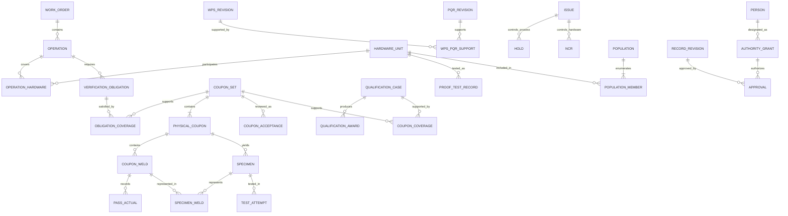

# Proposed relational database schema

Conceptual/logical design, not executable migrations. PostgreSQL is recommended; exact field lengths and implementation naming are deferred. Supports R01–R53. Authority and system-of-record decisions remain subject to review.

## Key and revision conventions

Use internal UUID primary keys plus stable human-facing record numbers, unique within program/record type (external numbering rules TBD). Foreign keys express relationships; natural names and free-text serial ranges are not joins. Store actual measurements as decimals with explicit units, raw input and source; do not coerce a machine display setting into a physical unit. Times use UTC storage with timezone-aware display; historical unknown dates remain unknown. Record both worker/event time and digital entry time for assisted/paper entry.

A `ControlledRecord` supplies identity/type/program and references immutable `RecordRevision` rows. Mutable drafts use a version token; completed or approved revisions are frozen. An amendment creates a successor revision with reason and links, never an in-place overwrite. Approval binds a specific revision and its evidence manifest, not the mutable current pointer. Historical forms/rendering retain their form/requirement revision. Catalog changes cannot rewrite historical snapshots. “Frozen” is an application/database permission and revision policy; do not claim it prevents a database superuser from tampering. Separate administrative access, protected audit copies and backup controls support detection/recovery.

Statuses are distinct dimensions: draft/approved document status, evidence completeness, test validity, technical acceptance, qualification status, hold restrictions and shipment authorization. Explicit `not_applicable` includes a basis; null/unknown never means passed. The production applicability of any draft requirement must be separately resolved.

## Entity dictionary

`PK` is internal identity; `FK` references another entity. All program-owned entities carry `program_id` directly or through a mandatory parent. “Revision” below means a controlled record revision where evidence/approval must freeze.

| Entity / key relationships | Main fields / purpose |
| --- | --- |
| Program | PK, name, scope, baseline_bundle_id; separate from organization tenancy |
| Organization | PK, name, role in program; Picogrid/Cone/AM Kreations |
| Person; UserAccount; Membership | Person PK, name/organization references; optional login FK; membership unique per person/org/program; persons can exist without logins for paper records |
| ApprovalPolicyRevision | PK, program/organization/action scope, self_approval_allowed (initially true), effective interval, policy authorizer and revision. Approval references the evaluated policy; changing it does not rewrite prior approvals. |
| AuthorityGrant | PK, person, organization, action, scope, effective times, designation evidence, granted/revoked by; engineering authority distinct from system role |
| ControlledRecord; RecordRevision | Identity/type/number; revision number, status, predecessor, form revision, creator/entry times, immutable content/evidence references, frozen_at |
| Document; DocumentRevision; BaselineBundle | Document identity/revision/hash/file/status/approval; bundle links exact F/P/forms/drawings used; source draft status preserved independently of software-baseline lock |
| RequirementDefinition; RequirementRevision | Stable ID, source section, applicability, type, units, limits or unresolved value, approval status; route logic not editable through generic form fields |
| VerificationPlanRevision; PlanRequirement | Job/joint/qualification applicability, interval/count basis/due point, controlled drawing/method/criteria references, required counts; unknown remains unresolved |
| PartDefinition; DrawingRevision; JointFamily; WeldFeature | Drawing controlled document reference, family/program scope and weld location; family applicability prevents corner exceptions from becoming global |
| MaterialLot; FillerLot; MaterialUse | Spec/temper/heat/lot and controlled properties; typed use FK to operation/coupon with lot and actual thickness; required traceability granularity TBD |
| Machine; ToolingRevision; MaintenanceEvent | Unique machine/serial/model; fixture/tooling revision; event actor/time/classification/impact/rationale and linked A/C/B obligations; gas/filler changes recorded only to required scope |
| WorkOrder; ExternalRecordLink; MappingRevision | Job/traveler IDs, owner organization, controlled external system/document reference, approved equivalence mapping/version; system ownership proposed primary here |
| HardwareUnit; ProductionBatch; BatchMembership | Serial/part/drawing; explicit batch member rows; unique serial namespace TBD; membership preserves history across splits |
| Operation; OperationHardware | Work-order/joint/WPS revision/operator/machine/setup and explicit unit membership; separates different welding contexts within a job |
| SetupSnapshot; ActivityEvidence | Material/filler/tooling/WPS/machine/operator context; documented welding activity source/person/date for continuity; no invented mandatory per-weld log |
| ReadinessReview; GateDecision | Operation/population/revision, applicable requirement checklist/results and evidence, decision, authority reference; several reviews over time |
| TriggerEvent; VerificationObligation; ObligationCoverage | Trigger source/reason, exact applicable scope and checkpoint, required A/B/C route; coverage links evidence with matched dimensions and authorization basis |
| Population; PopulationMember | PK and explicit hardware members; reference serial range display plus expanded membership; reused for coupons, holds, NCRs, authorizations and shipments |
| WPS; WPSRevision; WPSPassRequirement | Instructions and permitted ranges/technique/material/joint/scope; separate pass rows; approved requirement sources, supporting PQR revision links |
| PQR; PQRRevision; WPSPQRSupport | Actual qualification evidence/conclusion/limitations; many-to-many controlled support mapping to WPS revisions; never production nominal/ranges inferred from actuals |
| QualificationCase; QualificationSubject; QualificationAward | Case type/scope/origin/plan; one or more typed operator/machine/WPS subjects; award per subject/scope/approval/evidence and status |
| DevelopmentCase; DevelopmentTrial | Objective, trial sequence/variables/next action/conclusion, actual evidence references and preliminary WPS links; never production hardware |
| CouponSet; PhysicalCoupon; CouponPurpose; CouponCoverage | Set identity/purposes/plan/caller; physical coupon identity/joint/assembly/material/setup; distinct coverage of obligations/cases/populations; A/B are separate welds on one physical coupon assembly (user clarification), not two physical coupons |
| CouponWeld | PK, physical_coupon_id FK, side/feature label (A/B where applicable), joint/location; separate welds within one assembly, each with its own actuals/observations/tests. Unique label per assembly; applicable geometry from drawing, not inferred from suffix alone. |
| PassActual; Observation; Measurement | CouponWeld FK and pass ordinal; raw parameter value, typed value if verified, units/source/readout; after-pass/finished observations and actual dimensional data |
| Specimen; PreparationEvent | Parent physical coupon plus SpecimenWeld link(s) to represented CouponWeld, location/orientation/drawing/layout, extraction method/person/time, geometry/integrity evidence; preserves pre-cut sequence |
| Inspection; InspectionResult | Typed target FK, stage (pre-finish/post-finish/pre-cut/final/specimen integrity), criterion revision, inspector/time, actuals/result/evidence; supports non-numeric observations |
| TestProvider; TestMethodRevision; TestAttempt | Lab/in-house identity and supporting competency evidence; specimen/method/fixture/equipment/date/report, completion/validity/invalidity reason, technical result and prior attempt link |
| CouponAcceptance; AcceptanceEvidence | Set/required test attempt coverage, criteria revision and Cone acceptance decision; test pass alone is not signoff |
| ContinuationAuthorization | In-process scope, pending coupons, source procedure/approval, conditions; no shipping privilege implied |
| ProofTestRecord; ProofLoadItem | One test occurrence per enclosure serial with plan revision, actual load arrangement/attachments, static/drop/post-inspection, height/reference/fixture/support/impact/rigging evidence and acceptance; retests remain separate occurrences |
| Issue; Hold; HoldVerification | Common issue/context; hold scope/origin/stop restriction/responsible party/status; H-required A operator/machine/time/result and B/C evidence; no routine A log table |
| ContainmentAction; NotificationRecord; CorrectiveAction | Population/last acceptable check/basis/segregation; Picogrid notice evidence/recipient/time (automated send not assumed); investigation/action/effectiveness evidence |
| NCR; DispositionRevision; DispositionAction | Nonconforming/suspected hardware/evidence, Picogrid approved disposition/conditions, execution/reinspection/retest and closeout; distinct from process hold closure |
| Restriction | Typed work/ship/machine/population restriction, originating hold/NCR/pending result/qualification, scope/reason and authorized resolution; derived restrictions retain source |
| ReleaseAssessment; ReleaseDecision | Gate 2 population/evidence manifest/requirements and revision; decision/normal or pending-coupon route, Cone release evidence and applicable Picogrid authorization; release not physical shipment |
| ShipmentAtRiskAuthorization; Shipment; ShipmentMember | Picogrid decision, pending coupon IDs/population/conditions/approval reference; actual shipment/CoC and serial membership, release reference and later result follow-up |
| Approval; ApprovalEvidence | Specific revision/action/decision/conditions/person/grant/policy revision; digital or accepted signed-paper source provenance, with performer/entry/approval attribution and no mandatory worker digital reconfirmation; entering a paper approval distinct from granting it |
| Attachment; EvidenceLink | Private object key/version, checksum, size/type, original name, uploader/date, record/revision link; source and derived files distinguished |
| WorkflowInstance; CallerFrame; WorkflowEvent | Section/checkpoint/context/version/parent; call site/return target/origin gate; durable business transitions only, with authority/evidence references; no individual routine-A PASS audit |
| ImportBatch; ImportRow; SourceArtifact | Source checksum, sheet/cell coordinates, raw value/formula/notes, mapping version, validation warnings and assigned record; no guessed original date or missing source fidelity |
| AuditEvent | Actor/entry channel/action/target revision/time/request ID/reason and relevant before/after reference; sensitive access and controlled changes; exclude routine passing A as a new QC log |

Typed links: implement explicit FKs or constrained type-specific link tables for inspections, approvals and evidence. Avoid unconstrained `(entity_type, id)` fields that can reference nonexistent records. JSON may retain raw imported data and genuinely variable method details; workflow, subject identity, population, approvals and critical acceptance data remain relational.

## Cardinalities

A draft set can have no physical coupons yet; the set→coupon one-or-more diagram describes a completed set, not a creation-time database constraint. Evidence-link tables also connect coupon sets to PQRs and awards; a shared set never substitutes for separate approvals.

## Clarified coupon identity example

For the clarified A/B convention: `M1C1` identifies the shared coupon assembly context, with separate weld records `M1C1-A` and `M1C1-B`. Each weld may have root/cover passes and its own observations/results. Smaller pieces extracted later are specimens with separate IDs and source-weld links. Keep the delivered full IDs and source provenance; verify individual historical groupings before merging imported records. Two welded sides of one assembly are not automatically two physical coupons toward the approved coupon count. The AMK-TTS drawing in P4.5 (PDF page 16) was re-inspected; it supports the assembly representation, while the A/B naming comes from the user's clarification.

## Owner authority exception

Model the user's personal unrestricted owner role separately from ordinary AuthorityGrant checks. An OwnerOverride records actor, target revision/decision/restriction, action, reason, time and effect, retaining the original evidence. All ordinary role restrictions remain enforced; an owner exception is explicit and attributable rather than a hidden status edit or a forged organization approval. This is product direction Q19, not approval of source-document production status.

## Integrity and transaction rules

- Permit self-approval initially. Evaluate it only after validating the approver's effective action/scope authority and all applicable qualification/evidence requirements; it cannot satisfy or bypass those checks. When an effective authority-approved policy forbids it, compare the approver to the relevant actual performer/preparer identities (including paper records), not just entered_by. Enforce on the server at decision time; retain historical approvals under their original policy. The personal owner exception remains explicit and attributable.

- Enforce unique revision numbers within record identity, unique physical machine identity, positive pass/specimen sequences and FK existence. Serial uniqueness scope is an explicit decision, not inferred from names.
- Prevent cross-program links. Scope population members and material/setup context to the evidence they actually represent. Display compact ranges only when backed by explicit member IDs; serial text is not a sortable production counter.
- Distinguish validity (`not_evaluated`, `valid`, `invalid`) from result (`pending`, `pass`, `fail`, `not_applicable`) and from authorized acceptance. A result cannot count for acceptance until valid, complete, applicable and accepted under the approved basis.
- Enforce required applicability, test sequence, physical coupon count and evidence scope using transactional domain validation, not only simple SQL checks. Store requirement/plan revisions used by each decision. Configuration cannot create authority or rewrite F routes.
- Cone designated approver may resolve a process hold after required checks pass and the problem is resolved; do not cascade closure to NCR or shipment restriction. One source restriction cannot be cleared by resolving another. Global machine scope and hardware-specific scope must both be checked.
- Release decisions lock/recheck affected operation, restrictions, qualification, evidence revisions and authority; serialize competing hold/release changes using shared locking/version conventions. All write paths, including imports, use the same restrictions. An approval binds the exact checked manifest. Repeated requests are idempotent.
- In-process pending continuation retains independent awaiting-test obligations and shipment restrictions. At-risk authorization links exact serials and pending tests; a known failure is never pending. New results do not rewrite past authorization; they create follow-up restrictions/records as applicable.
- A frozen record may refer to a newer correction via an amendment link, but its approved evidence bundle remains reproducible. Do not hard-delete completed quality records; retention/deletion/anonymization rules await Q04.
- No automatic numeric acceptance using unresolved draft values. Source and approval status accompany each criterion; unknown applicability is review-needed, not silently N/A.
- Routine passing A checks are transient work guidance, without a new stored individual pass record or timestamp trail. Do not use operational telemetry to reconstruct such a log. Exceptions/H checks are durable as required. How “current for setup” is confirmed without new logging needs Q12; do not equate missing routine log with missing required activity.

## Search, export and integration

Index program + human number, serial, job, machine, WPS revision, open hold/NCR, outstanding tests and approval queue. Derive registers from base records; generated search indexes/caches are never authoritative and are permission-filtered. Freeze export manifests when used as completed dossiers.

Use external system + external ID + revision as a unique integration identity and record synchronization direction/last verified state. Initially prefer reviewed import/export and attached signed records over bidirectional writes. Cone variants require approved field mappings before production use (P3.6.1). Business keys, merge handling and ownership must be agreed before enabling synchronization.

## Comprehensive-review amendments (proposed, not migrations)

- A01 confirmed: persist official QC decision/release history here; ExternalRecordLink/MappingRevision identifies authoritative source of each external fact. No two independently editable masters.
- A02 confirmed: add explicit `acting_capacity` to Approval/ReleaseDecision/OwnerOverride, with actual Person signer and applicable AuthorityGrant/delegation reference. A Picogrid delegate acts only within recorded delegation; owner-only intervention remains distinguishable. Do not infer a delegation has already been granted. Capture signature/action time and entry time separately.
- A03 confirmed: add a paper-fallback reconciliation case referencing signed source, original action times, current-status/authority check evidence, later entry, conflicts and reviewer resolution. Detailed B45 controls are not yet specified; this does not require a disconnected digital client.
- A08 confirmed: include an explicit evidence dependency/decision-basis relation and impact-review case linking source revision → inspections/tests/awards → Gate decisions/releases → shipments/serials. Original approved manifests remain frozen; current eligibility/review state can differ. Flag dependent records and pause further affected approvals/releases/shipments pending authorized review; detailed scope, clearance and reapproval behavior remains B33–B35. Historic decisions/shipments remain intact; no automatic recall or new disposition is inferred.
- Track restriction applicability separately for **production**, authorized verification/test welding, movement and shipment. An H stop must prevent production without making H's own required A/B/C verification impossible. Specific eligibility/conditions are B18/B27, not an unrestricted verification bypass.
- A04 is confirmed: multiple serial/joint operations within one work order may have independent outcomes/partial shipment, with explicit membership history. A05 is confirmed: shared Lander program reads, separate edit/approval grants, no initial lab accounts. A06 confirms senior organizational management of own scoped backup grants/revocation and self-approval policy. No proposed field establishes a new engineering acceptance rule.
