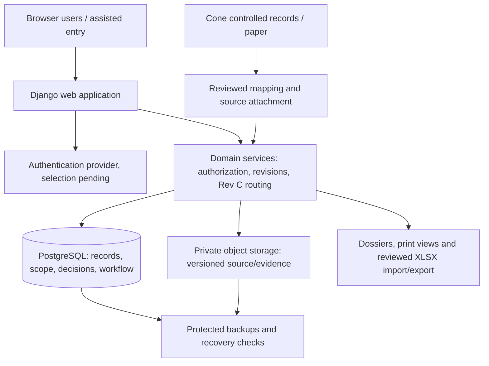

# Technology evaluation and architecture recommendation

This is a qualitative design evaluation for the supplied requirements, not a benchmark or an installed prototype. The repository currently has no application, dependency manifests or existing platform constraints. Exact supported versions and hosting-service compatibility must be checked when implementation is authorized; none have been installed for this design task.

## Decision criteria

Prioritize transactional relational integrity, explicit server-side authority, revision/evidence preservation, conditional forms and reports, maintainability for a small team, secure cross-organization access and paper/assisted entry. These needs outweigh a complex client application or independently deployed microservices for the initial product. No scale/uptime target has been supplied; user counts, attachment volumes, retention and recovery objectives remain to be estimated with the owners.

## Candidate comparison

| Option | Fit / strengths | Costs / limits | Recommendation |
| --- | --- | --- | --- |
| Python Django + PostgreSQL, server-rendered templates with selective HTMX/JavaScript | Mature relational modeling/migrations, authentication integration, forms, transactions and permission hooks; Python useful for XLSX import/export; one deployable application | Must build domain authority/state logic explicitly; framework admin alone is unsuitable for production QC decisions; complex interactions may need targeted JavaScript | Preferred starting point if no existing team/platform preference |
| TypeScript React/Next.js + PostgreSQL + ORM | Strong interactive forms and shared client/server language; broad frontend ecosystem | More explicit choices for auth, background tasks, audit, controlled revisions and state; duplicate client/server validation risk; larger initial surface for a small team | Good alternative if long-term maintainers prefer TypeScript or richer client interaction is justified |
| ASP.NET Core + PostgreSQL or SQL Server | Strong typed backend, relational transactions, enterprise identity fit, maintainable explicit domain services | Requires .NET expertise; Microsoft identity advantage depends on actual accounts/tenant constraints, not assumed from organization names | Prefer if Cone/Picogrid support team and identity environment already use .NET |
| Managed low-code/forms platform | Fast basic records/screens and manual entry | Must prove caller-aware routing, exact revisions, custom authority, immutable evidence and exports; per-seat/external access and lock-in vary; cannot accept platform “approval” as sufficient by assumption | Evaluate only with a requirements proof; do not make it default for core QC |
| Spreadsheet-backed app / continued shared XLSX | Familiar, minimal retraining | Poor relational integrity, concurrent revisions and independent authority enforcement; reproduces redundant data and ambiguous state | Keep XLSX as source/import/export format, not proposed authoritative runtime database |

No vendor pricing, licensing commitments or compliance certification is asserted. A framework does not supply engineering qualification or production approval.

## Recommended logical architecture

One modular monolith with modules for identity/authority, controlled requirements/documents, production, verification/testing, qualification/development, issues/disposition, release and reporting/import. Boundaries are code organization, not microservices. Route-specific domain commands handle decisions through database transactions; screens never set protected status fields directly. Django's administrative interface may support safe catalog administration, not bypass workflow or engineering approvals.

Use PostgreSQL constraints plus domain validation for scope/sequence, shared locks/version checks for decisions, and explicit immutable revision references. Store evidence objects privately with metadata/checksum in PostgreSQL; preserve object versions used by approvals. Use a transactional outbox only if later asynchronous exports/notifications/integrations require reliable delivery. Initial notifications can be a visible task queue and recorded external notice; sending mail or messages is not assumed authorized. No Redis/Celery cluster is needed merely to start; choose a durable worker when document processing becomes slow enough to justify it.

Recommend explicit section-specific transition services and a tested transition table over a general BPMN/workflow editor. Requirement applicability/limits can be versioned data; arbitrary route editing risks changing locked Rev C. A controlled later baseline revision is a separately reviewed change, not an administrator configuration shortcut.

## Hosting and operations proposal

Use a managed application runtime, managed PostgreSQL and private managed object storage in a region approved by the owners. Choose vendor only after Q03/Q04 and budget/maintainer constraints; no account/service has been created. Keep separate development, review/test and production environments with no test record capable of masquerading as production evidence. Use controlled deployment/database migrations and protected secrets. Development snapshots do not authorize production process use.

Proposed operational capabilities: TLS, encrypted storage/backups, least-privilege service identities, structured error reporting without document/credential leakage, monitored availability, backup schedules plus restore rehearsals, attachment/object version recovery, and documented incident handling. Retention and recovery time/data loss objectives are TBD; do not pick arbitrary seven-year retention or uptime promises. Backup deletion and record deletion must honor the eventual retention policy and external source ownership.

Prefer a standard identity provider using supported OIDC/SAML integration if the organizations can share access appropriately. Otherwise, evaluate application-managed accounts with MFA and recovery policies. Membership/designation needs an explicit approval process; email domain alone is insufficient engineering authority. Session-based web security includes CSRF protection, output escaping, secure cookies, rate limiting, authorization on every command/read/download and tenant/program-scoped queries. Detailed threats to test: forged object IDs, wrong-organization approval, stale evidence release, helper impersonation, attachment substitution and privileged status edits.

Upload originals as untrusted content: validate allowed type/size, quarantine/scan according to selected platform, private downloads and safe rendering. Preserve originals; derived previews are separate. Do not execute workbook macros/formulas or imported instructions. Formula values and raw text remain source evidence, not code. Export mitigates spreadsheet-formula injection while retaining a separate verbatim source artifact.

## Online and paper boundary

User reports general shop-floor Internet access and a need to include manual work. Recommend online decision-making with paper forms/signed reports attached and attributed by assisted entry. This meets the stated direction without assuming disconnected synchronization is required. Do not promise offline digital approvals. If offline digital use later becomes required, revisit local encrypted storage, cached requirement revisions, identity validation, queued commands, duplicate IDs, concurrent holds and stale-authority reconciliation before implementation. Physical work recorded on paper still needs the agreed authorization and traceability; connectivity is not a waiver.

## Validation strategy for later implementation

1. Establish reviewed examples for each F branch/caller return and Q06/Q07/Q09 resolution before writing routing code.
2. Test domain transitions, authority grants and evidence applicability using real failure cases in the RTM; not only form rendering.
3. Test multi-trigger coverage, validity versus rejection, combined qualifications with separate signers, H/NCR independence, conditional shipment and later results.
4. Test concurrent hold/release and evidence amendments, API/direct command denial, attachment security and historical dossier reproducibility.
5. Reconcile migration counts/hashes and sampled source cells; preserve 26 current development entries with unknowns, without fabricated qualification or dates. Validate approved Cone mapping if used.
6. Exercise operator, assisted-entry, Cone reviewer and Picogrid approval workflows on representative devices. Demonstrate paper-source attribution and restore a complete record/evidence dossier from backup.

All checks above are proposed, unrun application acceptance work. Source reading and document consistency checks are the only validation performed in this task.

## Review sequence

First resolve system ownership, access/authority, signature/manual method and central routing ambiguities. Then confirm technology/hosting with maintainers, refine the schema and screen prototypes for review, and only implement after separate authorization. Engineering TBDs can remain represented as unresolved data during development; no development functionality may silently supply their values or claim production readiness.

## Reopened architecture constraints

This technology recommendation awaits explicit architecture review/approval; A07–A08 are resolved and A04–A06 scope/access/grant model is confirmed. A01 confirms official application QC decision/release history with approved Cone source mapping. A02 requires separate signer/capacity/delegation attribution; A03 allows a controlled paper outage process, not an assumed offline digital client. Confirmed evidence dependency and impact-review behavior A08 adds domain data/services for flags and paused further affected decisions; it does not by itself require microservices. A07 records no compulsory platform/login/signature/storage constraints currently known. Proceed on this bounded architecture assumption and verify any later customer constraints before operational deployment; no mandatory security or retention requirement is waived. Operational security, recovery, retention, maintenance and acceptance B40–B44 are required before affected functions/operational deployment, not optional C improvements.
