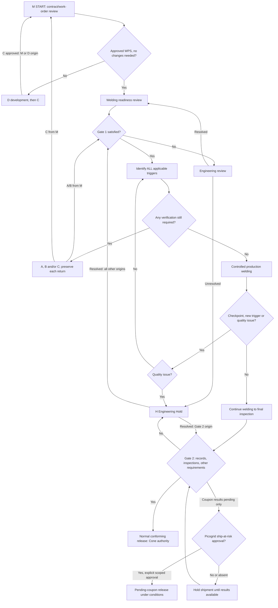

# Workflow-state model

Rev C remains locked for software development and retains discussion-draft production status. This model proposes software representations of its steps, not additional engineering gates. Sources: F M/A/B/C/H/D, P Part 2. See R02–R40 and questions Q05–Q12.

## Owner exception and confirmed routing decisions

Normal Rev C routing below remains the baseline. The latest user direction adds personal unrestricted application owner authority, represented by explicit attributable interventions; organizational users remain on the ordinary routes. An override does not rewrite the underlying evidence or masquerade as another organization's approval. The user has now accepted Q06/Q07 for software design: M/D-origin qualification returns through M START/work-order-WPS review and readiness; H-origin qualification returns through verification acceptability and problem-resolution confirmation before authorized closure. Source wording discrepancies remain recorded for controlled alignment; the PDFs are unchanged.

## Model structure

Do not put the whole job into a single `status` dropdown. A job can have multiple operations, qualifications, active holds, pending tests and serial-specific release decisions at once. Use separate state machines for:

- Master operation routing (M) and caller-aware A/B/C/D/H subprocess instances.
- Evidence completeness, test validity and technical acceptance.
- Qualification awards and scoped work restrictions.
- Hold investigation/closure, hardware NCR disposition, shipment authorization and actual shipment.

A durable subprocess call records caller instance, call site, context (operator, unique machine, WPS, joint, population), required obligations and exact return target. Nested calls use frames; completing B from C must resume C, not M. Record an H origin gate and the underlying affected scope independently of the most recent nested verification. Multiple active holds are not overwritten by a single job status.

Routine A checks are an exception to durable per-event workflow logging: display/guide the check and return transiently without creating individual routine passing A records. Persist only the source-required exception/H evidence. An aggregate M readiness or trigger decision must not become a hidden list of routine A pass timestamps.

## Master M

Diagram condenses nested subflows; the return table below is authoritative for this design. Q06 concerns the explicit START return versus graphic arrow placement. No “resume welding” transition is exposed from a finished subprocess or hold.

M states/checkpoints: `start_review`, `wps_assessment`, `readiness_review`, `gate_1`, `engineering_review`, `trigger_review`, `awaiting_verification`, `controlled_welding`, `in_process_review`, `final_inspection`, `gate_2`, `awaiting_coupon_release_results`, `release_authorized`. “Awaiting verification” is a software coordination state, not an additional F gate. M.2.9 contains pre-/post-finish inspection details without inventing a third gate.

Gate 2 proposed predicate: required documents complete, applicable final VT and dimensions accepted, all other approved applicable requirements accepted, no unresolved applicable restriction incompatible with the route, and effective release authority. Normal route additionally needs applicable coupon acceptance. Pending-coupon route may defer only coupon results, with explicit Picogrid scope/conditions. Approval never converts a known failure or invalid evidence into a pending acceptable result.

Interim authorization is not modeled as an unrestricted override. Its signer, scope, permissible gaps and review route remain Q05. The design cannot decide whether a specific gap is eligible.

## Subprocess transitions

| Section / checkpoint | Result | Next step and side effects |
| --- | --- | --- |
| A entry | From M, B, D or H | Check representative strike plate, filler in WPS and visual/machine condition |
| A acceptable? | Yes | Acknowledge; persist H-required PASS/exception evidence only; caller return per table |
| A acceptable? | No | Operator self-check |
| A problem found/fixed? | Yes | Re-weld A; no automatic NCR for minor fixed issue |
| A problem found/fixed? | No | H; open hold retains origin/context and applicable restrictions |
| B preparation | Preconditions defined by plan | Confirm current A, prepare required representative physical coupons; pre-cut inspections, specimen preparation/integrity then applicable tests |
| B in-process pending decision | Continuation not authorized | Stop production pending results; keep coupon/hardware/test linkage; when received → B validity |
| B in-process pending decision | Authorized continuation | Return M Gate 1 for authorized production context; retain B awaiting result and hold shipment. Later results → B validity/acceptance, then caller return |
| B preproduction or qualification | Tests incomplete | Await required evidence; no assumed in-process continuation shortcut |
| B tests complete/valid? | No, obvious correctable cause | Correct and repeat B preparation; retain previous attempt and invalidity reason |
| B tests complete/valid? | No, cause not obvious/correctable | H; no automatic valid weld rejection |
| B tests complete/valid? | Yes | Evaluate all approved acceptance criteria |
| B valid acceptance? | No | Weld nonconformance: contain affected population, NCR, Picogrid disposition, H |
| B valid acceptance? | Yes | Cone designated acceptance recorded; caller return |
| C entry/scope | One or several qualification types | Determine exact subjects/scope; always run B and return |
| C evidence validity | Incomplete/invalid | Hold qualification case, obtain valid evidence and repeat B; this C evidence hold is not automatically a hardware NCR |
| C acceptance | Fail | Not qualified; no welding under change; H |
| C acceptance | Pass | Required organizational approval for each award, record scope/limits; no automatic qualification from test pass |
| H entry | Any eligible A/B/C/M issue | Stop/tag machine/job; identify origin; determine hardware impact; contain/notify Picogrid if potentially affected |
| H troubleshooting | Action completed | Document cause/actions; always A; H remains open |
| H after A | Coupons/requalification required/wanted | B or C; required after failed coupon/qualification |
| H verification acceptability | No | Escalate, return troubleshooting; hold persists |
| H verification acceptability | Yes | Assess whether problem is resolved |
| H problem resolved? | No | Escalate; hold remains open |
| H problem resolved? | Yes | Cone designated approver records corrective action/closure after required checks pass and problem is resolved; return correct M gate; hardware NCR/disposition and shipment decisions remain separate |
| D entry | WPS new/essential change requiring development | Define joint/material/weld requirements; A first unless current; develop/test separate coupons and record actuals |
| D acceptance | No | Adjust parameters and repeat development |
| D acceptance | Yes | Preliminary WPS → C procedure qualification → M START after approved qualification |

D test applicability Q09 remains unresolved. H-origin C resume Q07 is accepted for software design as described above; retain the procedure wording discrepancy for controlled source alignment.

## Caller return table

| Completed section | Caller / call site | Return |
| --- | --- | --- |
| A | M verification | M Gate 1 |
| A | B preparation | B preparation after A |
| A | D trial | D trial after A |
| A | H verification | H coupons/requalification decision; H still open |
| B | M verification | M Gate 1 |
| B | C evidence | C complete/valid decision |
| B | H verification | H acceptability decision (P H.2.6) |
| C | M or D | M START / work-order-WPS review then readiness (Q06 accepted) |
| C | H | H verification acceptability then problem-resolved (Q07 accepted); P C.2.8 wording difference retained for controlled alignment |
| H | Gate 2 origin | M Gate 2 |
| H | Other origin | M Gate 1 |

P M.2.5 requires all triggers. Completing one subprocess does not discard other obligations; its return re-evaluates remaining coverage. H can call A→B→C nested paths without losing the original hold origin.

## Independent lifecycles

| Object | Proposed states / distinctions |
| --- | --- |
| Test attempt | Planned → awaiting specimen/report → received → validity assessed; valid result pass/fail or invalid reason/retest. Completeness, validity and result are independent attributes. |
| Coupon acceptance | Awaiting required evidence → awaiting Cone decision → accepted or rejected; invalid evidence returns for correction, not accepted/rejected weld by itself. |
| Qualification | Evidence pending → approval pending → qualified/not qualified; scope loss/requalification restrictions separately attributable. |
| Hold | Open/stopped → investigating → verification → resolution decision → closed, or escalated/open. Step labels do not permit production while hold scope applies. |
| NCR | Identified/contained → awaiting Picogrid disposition → authorized actions → verification → authorized closure. Reject/return states must retain disposition history. |
| Shipment | Not authorized → normal or pending-coupon authorization → shipped; later results tracked as follow-up. Never replace historical “shipped” with “unshipped” after a failed test. |

An outstanding in-process B can coexist with production after authorized Gate 1 return. This requires a pending-evidence task and a shipment restriction, not a state overwritten to “passed.” If B originated in C/H, no independent permission to bypass open qualification/hold restrictions is implied by a pending-results branch. Exact policy should be confirmed under Q10.

## Concurrency and corrections

Evaluate transitions on the server against the same committed revisions shown to the decision maker; stale forms must reload relevant evidence. Recheck scope and grants inside the decision transaction. Machine-wide holds and serial/job holds participate in release and welding checks. Correcting an attachment or test result after approval creates a revision/review task; it cannot silently alter a previously approved evidence bundle. Subsequent failure on already shipped hardware links the original release/at-risk approval and affected serials to H/NCR follow-up; no automatic recall instruction is invented.

## Proposed branch verification

- Exercise all A/B/C return callers and both H origin routes; no direct subprocess→welding path.
- Run concurrent A/B/C triggers; fully covered combinations can close obligations, partial coverage cannot.
- Demonstrate valid failure versus invalid test/retest and rejected-test history preservation.
- Exercise in-process continuation allowed/denied, with arrival of late pass/fail and separate shipment controls.
- Open a machine hold during a release attempt and reject the stale submission.
- Close a process hold while leaving an unresolved hardware NCR and shipment restriction effective.
- Use paper/assisted evidence with distinct worker/entry/approval identities; no helper impersonation.
- Keep routine A PASS unlogged while retaining H-required PASS and reportable exceptions.

These are design review scenarios; application tests have not been implemented or run.

## Reopened completeness review

The [71-entry branch inventory](workflow-coverage-review.md) expands every explicit chart step, outcome and caller return. Presence in the earlier model did not settle interactions B03/B15/B17/B18/B27/B28/B29. These remain open; no claim of implementation readiness or complete operational interpretation is made.

Owner-versus-delegate attribution A02 is now confirmed: actual signer and acting capacity retained; recorded applicable Picogrid delegation supports Picogrid decisions; owner-only interventions remain separate from normal chart decisions and original evidence. A01 confirms official application decision history. A03 confirms controlled outage paper fallback, whose detailed status-check/conflict reconciliation rules remain B45. No new ordinary QC route is silently inserted for these software record mechanisms.

Pending-evidence coordination also needs explicit work eligibility: an authorized in-process continuation may permit the specified Gate 1/trigger review to proceed while its test obligation remains pending. It must not be marked accepted, discarded, or restarted as a duplicate B set merely because M asks whether verification is still required. The applicable authority/scope remains B18; shipment restrictions and result follow-up stay independent.

A08 is now confirmed: incorrect supporting evidence automatically flags all identified dependencies and pauses further affected approvals/releases/shipments pending authorized scoped review. Preserve original facts, approvals and actual shipment history; Cone handles process review and Picogrid retains affected-hardware disposition. A review flag is a software control, not a new automatic NCR/disposition or recall instruction. Detailed impact/clearance rules remain B33–B35. All eight critical decisions are answered, but the architecture itself is still awaiting user review/approval.
